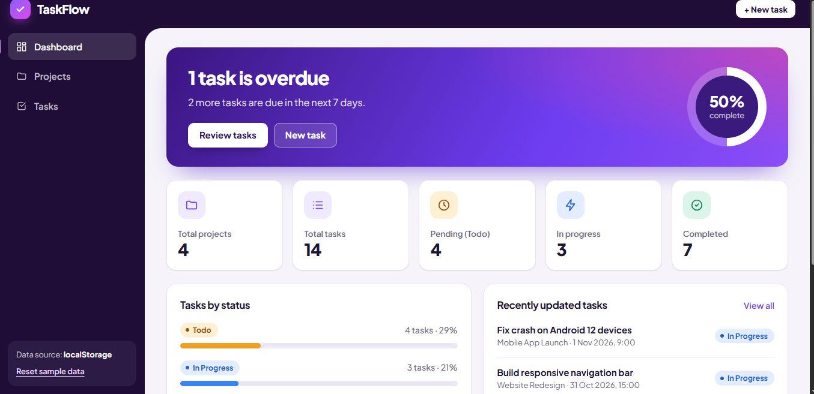
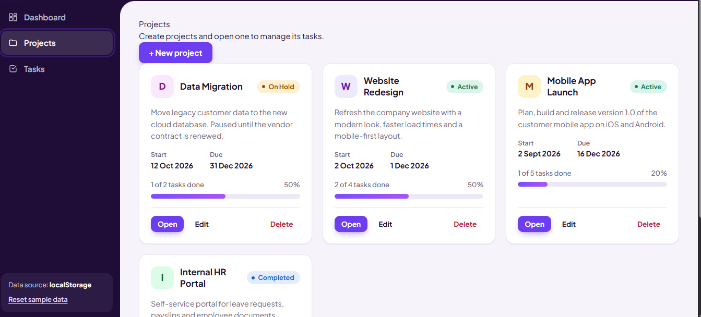
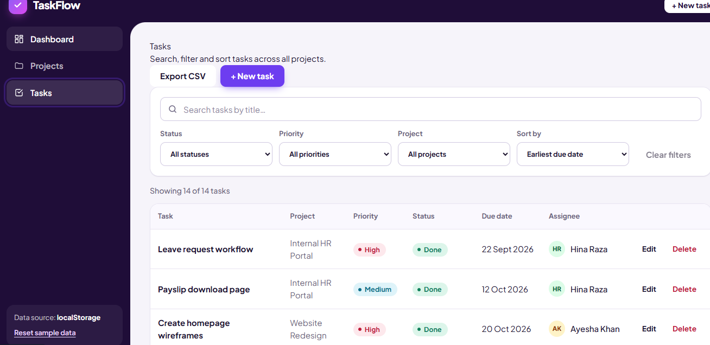

# TaskFlow — Project & Task Management Dashboard

A responsive project-management dashboard built with **React**. Users can create projects, manage tasks, track progress, and search / filter / sort tasks by status, priority and project.

Data is stored in the browser's **localStorage** by default (works out of the box, no backend needed) and can be switched to a **REST API** with a single environment variable.

| Dashboard | Projects |
| --- | --- |
|  |  |

| Tasks (search, filters, sorting) |
| --- |
|  |

---

## 1. Tech stack

| Area | Choice |
| --- | --- |
| UI | React 19, functional components, JavaScript (ES6+) |
| Hooks | `useState`, `useEffect`, `useMemo` (+ `useCallback`, `useRef`, `useId`, custom hooks) |
| Routing | React Router (`react-router-dom` v7) |
| Styling | Tailwind CSS v4 (utility classes in JSX) with design tokens in `src/index.css` |
| Font | Plus Jakarta Sans, self-hosted through `@fontsource-variable` (no CDN, works offline) |
| API | Fetch API (no Axios) |
| Data | REST API **or** localStorage fallback |
| Build tool | Vite |

No UI component library and no state library — everything is hand-written so it is easy to read and explain.

## 2. Getting started

**Requirements:** Node.js `^20.19` or `>=22.12`, and npm.

```bash
# 1. install dependencies
npm install

# 2. start the dev server (http://localhost:5173)
npm run dev

# 3. (optional) production build and local preview
npm run build
npm run preview
```

The first time the app loads, it fills localStorage with sample projects and tasks.
Use **"Reset sample data"** at the bottom of the sidebar to restore them at any time.

## 3. Using a REST API instead of localStorage

1. Copy the example env file and set your backend URL:

   ```bash
   cp .env.example .env
   # .env
   VITE_API_BASE_URL=http://localhost:8000
   ```

2. Restart `npm run dev` (Vite reads `.env` at start-up).

When `VITE_API_BASE_URL` is empty, localStorage is used. The sidebar always shows which data source is active.

### Endpoints the app calls

| Method | Endpoint | Purpose |
| --- | --- | --- |
| GET | `/api/projects/` | Fetch projects |
| POST | `/api/projects/` | Create a project |
| PATCH | `/api/projects/{id}/` | Update a project |
| DELETE | `/api/projects/{id}/` | Delete a project |
| GET | `/api/tasks/` | Fetch tasks |
| POST | `/api/tasks/` | Create a task |
| PATCH | `/api/tasks/{id}/` | Update a task |
| DELETE | `/api/tasks/{id}/` | Delete a task |

Backend expectations:

- JSON request / response bodies. `DELETE` may return `204 No Content`.
- The backend must allow **CORS** for the Vite origin (or proxy `/api` to it), including the `PATCH` and `DELETE` methods and the `Content-Type` header.
- Errors can return `{ "detail": "..." }` or `{ "message": "..." }`; the text is shown in the error banner.
- `id`, `createdAt` and `updatedAt` are generated by the backend. Ids are treated as **strings**.
- Deleting a project should also delete its tasks (done automatically in localStorage mode).

## 4. Features

**Module 1 — Dashboard** (`/`)
A hero that says what needs attention (overdue tasks, tasks due in the next 7 days) with an animated completion ring; total projects, total tasks, pending (Todo), in-progress and completed counts; a "tasks by status" summary with progress bars; the five most recently updated tasks.

**Module 2 — Projects** (`/projects`, `/projects/:projectId`)
List all projects (with task progress), create / edit in a dialog, delete after confirmation (its tasks are removed too), and open a project to see its own task list. A project has: id, name, description, start date, due date, status (Active / Completed / On Hold).

**Module 3 — Tasks** (`/tasks`, `/tasks/:taskId`)
Create, view, edit and delete tasks. A task has: id, title, description, project, priority (Low / Medium / High), status (Todo / In Progress / Done), due date, assignee. Overdue tasks are flagged.

**Module 4 — Search, filter, sort**
Search by title; filter by status, priority and project; sort by due date or creation date (either direction); **Clear filters** button. All controls work together, and the same controls are reused inside a project's page (without the project filter).

**Module 5 — Task form & validation** (`/tasks/new`, `/tasks/:taskId/edit`)
One form component for both create and edit; existing values are pre-filled when editing. Required-field checks, length limits, valid-date check, "due date cannot be in the past" (an already-overdue task can still be edited without changing its date), friendly messages shown next to each field, focus moves to the first invalid field. Deleting always asks for confirmation.

**Module 6 — Navigation & UI**
Dashboard, Projects, Project Details, Tasks and Create/Edit Task pages with React Router; loading indicators, empty states and error banners (with **Try again**); one-time success messages after create / update / delete; responsive layout — the sidebar becomes a drawer and tables become stacked cards on phones; keyboard-accessible dialogs and ARIA labels.

## 5. Project structure

```
task-management-dashboard/
├── public/favicon.svg
├── index.html
├── .env.example               VITE_API_BASE_URL (leave empty for localStorage)
└── src/
    ├── main.jsx               Entry: mounts <App /> inside <BrowserRouter>
    ├── App.jsx                Route table (all pages render inside <Layout />)
    ├── index.css              Tailwind import + theme tokens (colours, radii, shadows)
    │
    ├── pages/                 One file per screen
    │   ├── Dashboard.jsx
    │   ├── Projects.jsx
    │   ├── Projectdetails.jsx
    │   ├── Tasks.jsx
    │   ├── TaskForm.jsx       Create + edit (mode decided by the URL)
    │   ├── Taskdetails.jsx    Read-only task view
    │   └── NotFound.jsx
    │
    ├── components/            Reusable, mostly presentational pieces
    │   ├── Layout.jsx, Navbar.jsx, Sidebar.jsx
    │   ├── Dashboardcard.jsx
    │   ├── ProjectCard.jsx, ProjectForm.jsx
    │   ├── TableTask.jsx      Table on desktop, cards on mobile
    │   ├── Taskform.jsx       One form for create AND edit
    │   ├── TaskFilters.jsx, SearchBar.jsx
    │   └── ConfirmDialog.jsx
    │
    ├── ui/                    Tiny generic blocks: Alert, Avatar, Badge, Button, Card,
    │                          DetailItem, EmptyState, FormField, Loader, Modal,
    │                          OverdueTag, PageHeader, ProgressBar, controlClass
    │
    ├── Hooks/                 useTasks, useProjects, useTaskFilters,
    │                          useConfirmDelete, useFlash, useDocumentTitle
    │
    ├── services/              The ONLY place that talks to data
    │   ├── projectService.js, taskService.js
    │   ├── apiClient.js       fetch() wrapper for the REST backend
    │   └── localStorageDb.js  localStorage "database" with the same operations
    │
    ├── utils/                 Pure functions (no React)
    │   ├── taskHelpers.js, validators.js, dateHelpers.js, constants.js
    │   ├── Filterparams.js    Filters <-> URL query string
    │   └── csvExport.js       CSV export of the visible tasks
    │
    └── data/seedData.js       Sample projects and tasks
```

> File names are case-sensitive on Linux (Vercel, Netlify, GitHub Actions). Imports must match the file name exactly.

## 5a. Theme

The look is controlled from the `@theme` block at the top of `src/index.css`. Change `--color-shell` and `--color-primary` to re-colour the whole app.

| Token | Value | Used for |
| --- | --- | --- |
| `--color-shell` | `#1f0d38` (deep plum) | Navbar and sidebar frame |
| `--color-canvas` | `#f6f4fa` | Content panel background |
| `--color-primary` | `#6d3df0` (violet) | Buttons, links, focus rings |
| `--color-warning` / `--color-info` / `--color-success` | amber / blue / green | Todo / In Progress / Done (same meaning everywhere) |

## 6. How it works

```
 Page ──► hook ──► service ──► apiClient.js      (REST API)
                         └───► localStorageDb.js (localStorage fallback)
```

1. **Pages** (`src/pages`) decide *what* is on screen. They call hooks, handle loading / error / empty states and pass data down to components.
2. **Hooks** (`useTasks`, `useProjects`) keep the loaded data in state and expose `addTask`, `editTask`, `removeTask`… . `useTaskFilters` keeps the search / filter / sort state and uses `useMemo` so the list is only recomputed when the tasks or filters change.
3. **Services** are the single data-access layer. They check `USE_API` once and either call `fetch()` (`apiClient.js`) or the localStorage database (`localStorageDb.js`). Components never call `fetch` or `localStorage` directly, so switching data source touches nothing else.
4. **Components** are reusable and receive everything through props (`TaskForm` is used for create *and* edit; `TaskTable` / `TaskFilters` are used on both the Tasks page and Project Details).
5. **Utils** are pure functions: given the same input they always return the same output, which makes the filtering, statistics and validation logic easy to test and explain.

### Data model

```js
// Project
{ id, name, description, startDate, dueDate, status, createdAt, updatedAt }
//   status:   "Active" | "Completed" | "On Hold"
//   dates:    "YYYY-MM-DD"

// Task
{ id, title, description, projectId, priority, status, dueDate, assignee, createdAt, updatedAt }
//   priority: "Low" | "Medium" | "High"
//   status:   "Todo" | "In Progress" | "Done"
```

Dates are plain `YYYY-MM-DD` strings (what `<input type="date">` produces) to avoid time-zone "one day off" bugs.

### Validation rules (see `src/utils/validators.js`)

| Field | Rule |
| --- | --- |
| Task title | required, 3–100 characters |
| Task description | optional, up to 500 characters |
| Task project | required |
| Task assignee | required, 2–60 characters |
| Task due date | required, real calendar date, not in the past (unless unchanged while editing) |
| Project name | required, 3–80 characters |
| Project dates | both required and valid; due date not before start date |

Limits and option lists live in `src/utils/constants.js`; change them there once and forms, filters and validators all follow.

## 7. Notes

- **Extra routes:** besides the five required pages there is a read-only task page (`/tasks/:taskId`) and a 404 page.
- **localStorage keys:** `taskflow.projects` and `taskflow.tasks`. A short artificial delay (350 ms) is added in localStorage mode so loading indicators are visible, like with a real API.
- **Corrupted storage:** if the saved JSON is broken, the page shows an error banner; "Reset sample data" in the sidebar fixes it.
- **ESLint:** not bundled. If you add the Vite ESLint template, `eslint-plugin-react-hooks` v7 may flag `reload()` inside the `useEffect` of `useTasks` / `useProjects` (`react-hooks/set-state-in-effect`). It is the standard fetch-on-mount pattern and works correctly; switch to a data-fetching library if you want to remove the warning.

## 8. Scripts

| Command | What it does |
| --- | --- |
| `npm run dev` | Start the dev server with hot reload |
| `npm run build` | Create the production build in `dist/` |
| `npm run preview` | Serve the production build locally |